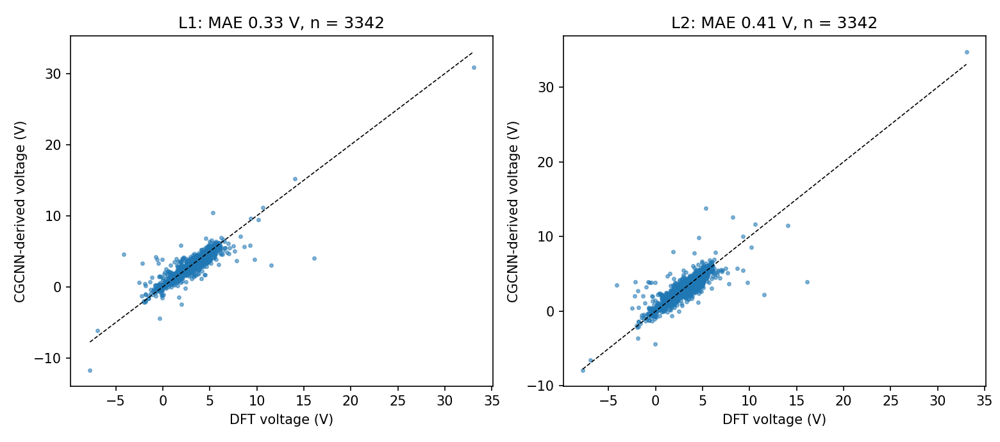
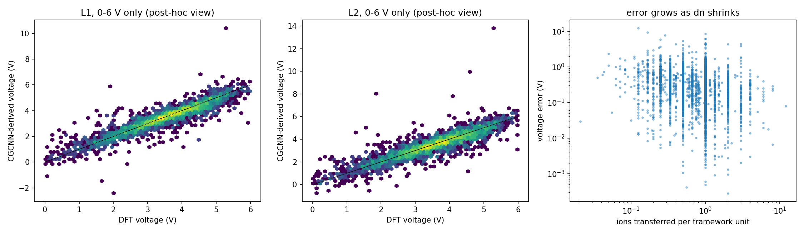

# CGCNN: from formation energy to battery voltage
 

 
Does a crystal-graph neural network's formation-energy accuracy survive the
subtraction that a lithium-ion cathode voltage requires?
 
I reproduce CGCNN (Xie & Grossman, 2018) on the Matbench formation-energy task,
then test whether voltages derived from its predicted formation energies are
accurate for 3,342 Materials Project Li-ion electrode pairs. The electrode
compounds (L1) or their whole chemical systems (L2) are held out of training.
The pass/fail limits (voltage MAE <= 0.25 V, Spearman >= 0.85) were fixed
before the experiment was run.
 
## Results
 
| Experiment | Formation energy | Voltage MAE | Spearman | Verdict |
|---|---|---|---|---|
| Matbench fold 0 | 0.0327 eV/atom (test) | - | - | reproduces the published ~0.033 |
| L1: unseen electrode compounds | 0.025 eV/atom at the end points | 0.331 V (95% CI 0.306-0.356) | 0.925 | MAE fails, Spearman passes |
| L2: unseen chemical systems | 0.032 eV/atom at the end points | 0.409 V (95% CI 0.384-0.438) | 0.895 | MAE fails, Spearman passes |
| L2, 3-seed ensemble | - | 0.368 V | 0.911 | MAE fails, Spearman passes |
 
* The ranking of voltages survives, their size does not: only 58% (L1) and
  47% (L2) of pairs are within 0.25 V of DFT.
* Formation-energy errors are amplified about 13x in voltage. The two end
  points' errors are only weakly shared (correlation 0.19 / 0.30); if they were
  fully shared the voltage MAE would be about 0.02 V.
* Three L2 training seeds agree (0.409 / 0.400 / 0.412 V), so this is not luck.
 

 
## How to run
 
1. Open the notebook in Google Colab (badge above) and choose
   Runtime > Change runtime type > T4 GPU.
2. Create a free Materials Project account, copy your API key and save it as a
   Colab Secret named MP_API_KEY (or paste it when prompted). Never commit a key.
3. Run the sections in order (1 to 14). Files are stored on Google Drive in
   a folder called cgcnn_run. Sections 8, 9 and 12 train models and take
   about an hour each on a T4.
 
## Repository structure
 
* notebooks/  the notebook (Sections 1-14)
* src/        fastcgcnn.py, the helper module (also written by Section 5)
* results/    figures, small result tables and environment.txt
 
## Data
 
Matbench task matbench_mp_e_form and the Materials Project (database release
2026.09.28). The notebook downloads them; no data is stored here.
 
## Limitations
 
Li-ion pairs only; one training seed at L1 and three at L2; one Materials
Project release (GGA/GGA+U labels, thermo type assumed and validated); L1
keeps near-duplicate polymorphs in training; the ensemble and selective
prediction analysis is exploratory.
 
## Acknowledgements and citations
 
* Xie, T. & Grossman, J. C. Phys. Rev. Lett. 120, 145301 (2018). CGCNN code:
  https://github.com/txie-93/cgcnn (MIT licence), cloned by the notebook.
* Dunn, A. et al. npj Comput. Mater. 6, 138 (2020) (Matbench).
* Jain, A. et al. APL Mater. 1, 011002 (2013) (Materials Project).
* Ong, S. P. et al. Comput. Mater. Sci. 68, 314 (2013) (pymatgen).
 
## AI assistance
 
The code was developed with AI assistance (Claude, Anthropic). I ran all
experiments and checked the results.
 
## License
 
MIT
